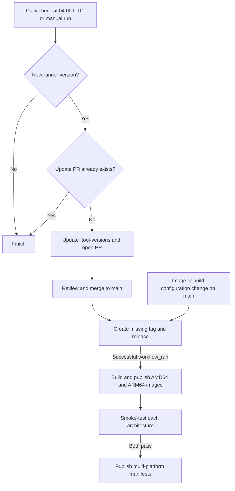

# OKE GitHub Actions Runner: configuration and operations

[](https://github.com/devopshouse/oke-github-actions-runner/actions/workflows/build-and-publish.yml)
[](https://github.com/devopshouse/oke-github-actions-runner/actions/workflows/validate.yml)

A custom image based on the official `ghcr.io/actions/actions-runner` image, intended for self-hosted runners on OKE with Actions Runner Controller (ARC). Builds target Linux AMD64 and ARM64.

[Back to README](../README.md)

This guide covers deployment requirements, ARC configuration, container builds, registry publication, automated workflows, and local development. Replace example names and paths with your own values. Workflow examples assume an already registered runner and credentials for the services they access.

## Contents

- [Overview](#overview)
- [Deployment requirements](#deployment-requirements)
- [Included tools](#included-tools)
- [Pull the image](#pull-the-image)
- [Use with ARC on OKE](#use-with-arc-on-oke)
- [Container builds](#container-builds)
- [OCI and Kubernetes access](#oci-and-kubernetes-access)
- [Registries](#registries)
- [Automation](#automation)
- [Monitoring](#monitoring)
- [Local development](#local-development)
- [Project structure](#project-structure)
- [Troubleshooting](#troubleshooting)
- [References](#references)
- [Licensing and maintenance](#licensing-and-maintenance)

## Overview

This project provides a ready-to-use GitHub Actions runner image for CI/CD pipelines on **Oracle Cloud Infrastructure (OCI)**, specifically **Oracle Kubernetes Engine (OKE)**. It combines the official GitHub runner with the tools needed to build container images, deploy Kubernetes workloads, and interact with OCI services.

With OCI CLI, kubectl, Helm, Kustomize, and container build tools already installed, pipelines can use a consistent environment instead of installing these dependencies during every job. The image supports both AMD64 and ARM64 nodes and is intended to run in OKE through Actions Runner Controller (ARC).

OCI authentication, Kubernetes access, and runner registration remain part of your deployment configuration; the image supplies the tools without embedding cloud credentials.

## Deployment requirements

Before selecting this image for an ARC scale set, prepare:

- An OKE cluster with Linux AMD64 or ARM64 worker nodes and enough capacity for runner pods and any build sidecars.
- Actions Runner Controller and a runner scale set configured for the target GitHub repository or organization.
- GitHub authentication managed through ARC, plus permission for workflows to use the scale set.
- Network access from the controller and runners to GitHub, the container registries, and any OCI or Kubernetes endpoints used by jobs.
- A reachable Docker daemon for Docker builds, or node and pod permissions that support Buildah namespace operations.
- OCI authentication and Kubernetes authorization for deployment jobs, configured separately from runner registration.

Follow the [ARC documentation](https://docs.github.com/en/actions/tutorials/use-actions-runner-controller) for controller installation and scale set authentication. The configuration below only overrides the runner image in an existing deployment.

## Included tools

| Purpose | Tools |
| --- | --- |
| Containers | Docker CLI, Buildx, Compose plugin, Buildah |
| Kubernetes | kubectl, Helm, standalone Kustomize |
| Oracle Cloud | OCI CLI in `/opt/oci-cli`, installed with uv |
| Development | uv, Python 3, Git, jq, yq, make, GCC, G++ |

The default user is `runner`. Docker CLI requires a reachable Docker daemon, such as ARC's Docker-in-Docker sidecar. Installing the CLI alone does not provide a daemon. Buildah is configured with VFS storage and chroot isolation; it still requires appropriate host and pod permissions.

## Pull the image

```bash
docker pull ghcr.io/devopshouse/oke-github-actions-runner:latest
docker pull ghcr.io/devopshouse/oke-github-actions-runner:2.337.0
```

Both tags select the platform matching the host. Publication also creates `sha-<commit>` tags. Version and `latest` tags can be rebuilt when image tooling changes; use an image digest when an immutable reference is required.

## Use with ARC on OKE

Set the image in your existing ARC runner scale set Helm values:

```yaml
template:
  spec:
    containers:
      - name: runner
        image: ghcr.io/devopshouse/oke-github-actions-runner:2.337.0
        command: ["/home/runner/run.sh"]
```

This is an image override, not a complete ARC installation. Keep your existing GitHub configuration, authentication, volumes, and Docker-in-Docker setup. The runner binary is supplied by the upstream image; this repository does not add a token registration entrypoint.

For Buildah, the node must allow user namespaces and the pod must allow the namespace operations it uses. The image includes `uidmap`, subordinate UID/GID ranges for `runner`, and a VFS default. Rootless execution is not guaranteed under restrictive seccomp, AppArmor, or `allowPrivilegeEscalation: false` policies. A privileged pod can retain the default `runner` user; root execution is also tested. Configure privileges according to your cluster policy, and validate on your actual OKE nodes.

The validation script checks Buildah builds as both `runner` and root in privileged containers. It does not establish that every unprivileged Kubernetes configuration will work.

Example steps on an already configured runner:

```yaml
jobs:
  build:
    runs-on: oci-oke-runner
    steps:
      - uses: actions/checkout@v7
      - name: Build with Buildah
        run: buildah bud -t example:local .
      - name: Render Kubernetes resources
        run: kustomize build k8s/overlays/production > rendered.yaml
      - name: Deploy
        run: kubectl apply -f rendered.yaml
```

Registry authentication and Kubernetes credentials must be supplied separately. Docker Buildx with the `docker-container` driver remains available for existing pipelines when a Docker daemon is configured.

## Container builds

### Buildah

The image sets `STORAGE_DRIVER=vfs` and `BUILDAH_ISOLATION=chroot`. It installs `uidmap`, `slirp4netns`, and `fuse-overlayfs`, and provides subordinate UID/GID ranges for `runner`. These defaults do not grant permission to create user namespaces on the host.

On an ARC runner whose pod and node permit Buildah builds:

```yaml
jobs:
  build:
    runs-on: oci-oke-runner
    steps:
      - uses: actions/checkout@v7
      - name: Build image
        run: buildah bud -t example:local .
      - name: Inspect image
        run: buildah inspect example:local
```

Replace `oci-oke-runner` with your runner scale set name. Registry authentication is required separately when pulling private base images or pushing build results. Validate the pod security settings with a Containerfile containing a `RUN` instruction, which exercises namespace operations beyond checking the executable version.

### Docker and Buildx

The image installs Docker CLI, Buildx, and Compose. Configure the daemon connection and any workspace volumes through your ARC deployment, for example using its Docker-in-Docker configuration. Preserve that configuration when overriding the runner image.

On an already configured runner:

```bash
docker info
docker buildx create --name pipeline-builder --driver docker-container --use
trap 'docker buildx rm pipeline-builder' EXIT
docker buildx inspect --bootstrap
docker buildx build --load -t example:local .
```

This example builds for the runner's native architecture. Installing Buildx alone does not configure cross-architecture execution or emulation.

## OCI and Kubernetes access

Runner registration, OCI authentication, Kubernetes access, and registry login are separate concerns. ARC manages the runner's GitHub registration; the image does not retrieve a GitHub token from OCI Vault or add a custom registration entrypoint.

Configure the OCI CLI authentication method supported by your deployment and grant the IAM permissions required by its jobs. Installing the CLI does not grant access to OCI resources. See the [OCI CLI documentation](https://docs.oracle.com/en-us/iaas/Content/API/Concepts/cliconcepts.htm) for authentication configuration.

For Kubernetes deployments, provide a kubeconfig or another supported authentication configuration, connectivity to the API endpoint, and the necessary Kubernetes authorization. Installing `kubectl` does not grant cluster access. Use the intended deployment context before applying resources:

```bash
kubectl config current-context
kubectl auth can-i create deployments --namespace application
kustomize build k8s/overlays/production > rendered.yaml
kubectl apply --namespace application -f rendered.yaml
```

The `application` namespace and the Kustomize overlay must already exist in your deployment setup. If the kubeconfig invokes the OCI CLI, both OCI authentication and Kubernetes authorization must be configured for that job.

## Registries

GHCR is the default destination, authenticated with the workflow's `GITHUB_TOKEN` and `packages: write`. The GHCR package must be public for anonymous pulls; verify package visibility after the first publication.

OCIR is optional. Set repository variable `OCIR_ENABLED` to `true` and repository secret `PIPELINE_SECRETS` to:

```json
{
  "OCIR_URL": "<region>.ocir.io",
  "OCIR_NAMESPACE": "<tenancy-namespace>",
  "OCIR_USERNAME": "<tenancy-namespace>/<username>",
  "OCIR_PASSWORD": "<auth-token>"
}
```

The local `setup-registry` action reads only these fields, masks credentials, and rejects missing values. OCIR publishes to `<OCIR_URL>/<OCIR_NAMESPACE>/oke-github-actions-runner` with the same tags as GHCR. No OCIR secrets are required when the variable is unset.

## Automation

Workflow definitions: [validation](../.github/workflows/validate.yml), [runner updates](../.github/workflows/check-actions-runner.yml), [releases](../.github/workflows/create-tag-and-release.yml), and [publication](../.github/workflows/build-and-publish.yml).

- **Validate:** PR builds and smoke tests on native AMD64 and ARM64 runners, without publishing images or reading OCIR secrets.
- **Check GitHub Actions Runner Version:** daily at 04:00 UTC, or manually. Reads the latest upstream release and opens an update PR when needed. The workflow checks PRs in all states for the version-specific branch and skips creation if one already exists.
- **Create Tag and Release:** image/build changes merged into `main` create a missing `v<runner-version>` release. Existing releases are preserved. Release notes include image usage details plus the full release notes fetched from the matching `actions/runner` release.
- **Build and Publish Docker Image:** follows a successful release workflow and checks out its exact source SHA. Publishes architecture-specific images, smoke-tests them, then assembles multi-platform manifests after both tests pass. A failed smoke test can leave an architecture-specific tag published without updating the shared manifests. Manual execution is restricted to `main`.
- **Dependabot:** weekly updates for SHA-pinned GitHub Actions. The runner version is managed separately in `.tool-versions`; other tool versions are Dockerfile build arguments maintained manually.

Allow GitHub Actions to create pull requests in repository settings. Default token permissions remain read-only, with additional permissions granted per job. PRs opened by automation may require approval before CI runs, depending on GitHub policy. CODEOWNERS assigns ownership to `@devopshouse/devops`.

Documentation changes in `README.md` and `docs/` do not trigger the release workflow. Image, test, and publication configuration changes on `main` do.

### Update and publication flow



The release workflow also succeeds when the release already exists, allowing the publication workflow to rebuild images. A manual publication run on `main` can build directly without creating a new release.

## Monitoring

Inspect the workflows and publication logs with the GitHub CLI:

```bash
gh workflow list
gh run list --workflow=check-actions-runner.yml
gh run list --workflow=build-and-publish.yml
gh run view <run-id> --log
```

Replace `<run-id>` with the ID from `gh run list`. Check the architecture jobs and the manifest job before using a new shared tag. The badges on the README link to workflow runs; a GitHub release alone does not confirm that publication completed.

To inspect the platforms available for an image:

```bash
docker buildx imagetools inspect ghcr.io/devopshouse/oke-github-actions-runner:2.337.0
```

## Local development

Build configuration lives in the [Dockerfile](../Dockerfile) and [.tool-versions](../.tool-versions); the validation checks live in [scripts/test-image.sh](../scripts/test-image.sh).

```bash
version=$(awk '$1 == "actions-runner" {print $2}' .tool-versions)
docker build --build-arg RUNNER_VERSION="$version" -t oke-runner:test .
bash scripts/test-image.sh oke-runner:test
actionlint
```

The smoke script requires a local Docker daemon and permission to start privileged containers. It checks tool versions, Buildah builds with a `RUN` instruction as both users, and Docker Buildx initialization through the host Docker socket. Run only against a trusted image. CI repeats the checks natively on both architectures.

Edit `.tool-versions` to change the runner version. Keep its format `actions-runner X.Y.Z`. Edit the Dockerfile to change tools; merging image changes rebuilds the image even when the runner version is unchanged.

When adding a tool, update the [Dockerfile](../Dockerfile), add an executable or behavior check to [scripts/test-image.sh](../scripts/test-image.sh), and update the included tools documentation. Verify the change on both supported architectures through the Validate workflow.

The Dockerfile pins `RUNNER_VERSION`, `UV_VERSION`, `KUBECTL_VERSION`, `HELM_VERSION`, `KUSTOMIZE_VERSION`, and `YQ_VERSION` through build arguments. OCI CLI and apt packages are resolved at build time. CI passes the runner version from `.tool-versions`; a direct build without that argument uses the Dockerfile default instead.

For an interactive inspection of a locally built image:

```bash
docker run --rm -it --entrypoint bash oke-runner:test
```

This starts a shell for inspecting tools; it does not register a runner with GitHub.

## Project structure

```text
.
├── .github/
│   ├── actions/setup-registry/action.yml  # Optional OCIR credentials
│   ├── workflows/
│   │   ├── validate.yml                  # PR validation
│   │   ├── check-actions-runner.yml      # Runner update PRs
│   │   ├── create-tag-and-release.yml    # Tags and release notes
│   │   └── build-and-publish.yml         # Images and manifests
│   ├── CODEOWNERS                        # Review ownership
│   └── dependabot.yml                    # GitHub Actions updates
├── .tool-versions                        # Runner version
├── Dockerfile                            # Image and tool configuration
├── scripts/test-image.sh                 # Tool and build smoke tests
├── docs/guide.md                         # Configuration and operations
└── README.md                             # Project overview and quick start
```

## Troubleshooting

- **Buildah namespace errors:** check the node's user namespace support and pod security profile. VFS does not bypass kernel permission checks.
- **Docker cannot connect:** verify the daemon or Docker-in-Docker sidecar and socket permissions.
- **Image pull denied:** check GHCR package visibility and registry credentials.
- **No update PR:** check Actions PR permissions, upstream API errors, and existing PRs for that version.
- **Missing image tag:** inspect both architecture jobs and the manifest job; a GitHub release can exist before image publication finishes.

## References

- [Actions Runner Controller](https://docs.github.com/en/actions/tutorials/use-actions-runner-controller)
- [GitHub Actions runner](https://github.com/actions/runner)
- [Buildah](https://github.com/containers/buildah)
- [uv Docker integration](https://docs.astral.sh/uv/guides/integration/docker/)
- [Oracle Kubernetes Engine](https://www.oracle.com/cloud/cloud-native/container-engine-kubernetes/)

## Licensing and maintenance

Maintained by `@devopshouse/devops`. Open an issue for questions or bugs. Included third-party tools retain their respective licenses; this repository does not grant a new project license.
